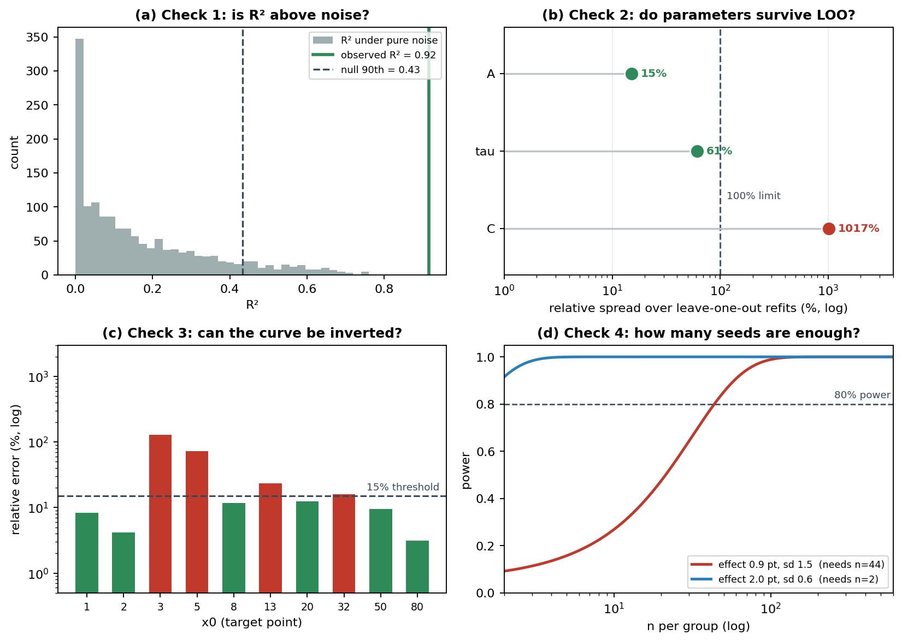

# identifiability

[](https://github.com/shuangyuelinglong/identifiability-py/actions/workflows/tests.yml)
[](pyproject.toml)
[](LICENSE)
[](CHANGELOG.md)

[English](README.md) | **简体中文**

**你用少数几个点拟合了一条曲线，然后从这条曲线上报出一个数字——半衰期、盈亏平衡点、成本倍数。本包检查你的数据到底能不能把这个数字定住。**

```bash
pip install git+https://github.com/shuangyuelinglong/identifiability-py.git
```

```python
import numpy as np
import identifiability as I

x = np.array([1, 2, 3, 5, 8, 13, 20, 32, 50, 80], float)
y = np.array([11.97, 9.18, 7.14, 9.50, 5.59, 3.17, 2.98, 1.69, 1.25, -1.15])

null, loo, cond = I.report(x, y, k=3)
```

```
====================================================================
identifiability checks (paper section 5.6 protocol)
====================================================================
  null    R^2=0.916  null_median=0.118 null_q90=0.456  p=0.0000  n=10 k=3  -> PASS
  loo     spread  A: 15.1%  tau: 61.2%  C: 1016.9%  -> FAIL
  cond    x=13  slope=-0.2053  rel_err=23.4%  threshold<15%  -> FAIL
  verdict: at least one check failed, do not use it quantitatively
```

**R² 是 0.92，三项检查里还是有两项不通过。** 曲线是真的——但有一个参数没有被数据定住，而且在真正需要的那个位置上，曲线无法反演。

---

## 这里的"可辨识"是什么意思

一个参数**在你手头的数据下可辨识**，意思是数据把它定住了：换一个同样好的拟合，它不会跑很远。

一个派生量——任何靠反演曲线算出来的东西——可辨识的意思是：测量上的一个小误差，不会放大成答案上的一个大误差。

**这两件事都可能在 R² 很漂亮的情况下同时失败。** 这就是本包要解决的问题。

---

## 拟合骗你的三种方式

**① 曲线其实就是噪声。**
4 个点拟合 3 个参数，无论数据是什么，R² 都会很好看。纯噪声在 n = 10 时 R² 的 90 分位就达到 0.43；n = 4 时有 46% 以上的概率超过 0.5。
→ *检查 1，`null_r2`*

**② 曲线是真的，但某个参数没被定住。**
模型拟合得很好，可若干组差别巨大的参数拟合得几乎一样好。去掉一个点，参数就移动百分之千。
→ *检查 2，`loo_spread`*

**③ 曲线没问题，但你从上面反演出来的数字有问题。**
你在曲线接近平的地方读了一个值。测量上 1% 的误差，变成答案上 50% 的误差。
→ *检查 3，`conditioning`*

**还有一种是关于"要跑多少次"：**
你报了 0.9 个点的差异，噪声有 1.5 个点，只跑了 3 个种子。这个检验几乎永远不会触发——不是因为效应不存在，而是你从一开始就没有足够的功效看见它。
→ *检查 4，`required_n`*

---

## 四项检查

| # | 检查 | 函数 | 通过条件 |
|---|---|---|---|
| 1 | **零分布** | `null_r2` | R² 明显高于同 (n, k) 下纯噪声能达到的水平 |
| 2 | **留一法** | `loo_spread` | 去掉任一点，参数几乎不动 |
| 3 | **条件数** | `conditioning` | 局部斜率够陡，反演是稳定的 |
| 4 | **功效** | `required_n` | 你实际跑的种子数达到了这个效应所需的量 |

**任何一项不通过，那个数字就不应被当作定量论据。**



*就是上面那条曲线，一项检查一个子图。(a) 实测 R² 远高于零分布——曲线是真的。(b) 但参数 C 在留一法下移动 1017%。(c) 十处里只有六处可以反演。(d) 0.9 个点的效应配 1.5 个点的噪声，每组需要 44 个种子；2.0 个点的效应只需要 2 个。*

---

## 谁需要它

任何"用少量点拟合参数曲线、再从曲线上取出一个数字报出去"的人：

- 衰减常数、半衰期、饱和水平；
- 从校准曲线上读出的阈值、盈亏平衡点；
- 通过反演标度律得到的成本或速度倍数；
- 从几次训练实验里得出的"我们测到效应是 X 个点"。

**如果你每个参数有几百个点，或者你只报"拟合看起来不错"，那不需要这个包。**

---

## 它从哪来

论文《数据增强惩罚的可辨识性》(ChinaXiv T202609.00792) 需要区分**"增强惩罚很小"**和**"我们的实验本来也测不出来"**。这要求把上面四项检查一致地施加到几百次运行上。后来发现它们可以复用，就整理成了这个包。

论文里怎么用、用的什么数字，见 5.6 节。本仓库是它的独立版本。

---

## 安装

```bash
pip install git+https://github.com/shuangyuelinglong/identifiability-py.git
```

需要本机有 `git`。**尚未发布到 PyPI**，所以 `pip install identifiability` 会失败。如果 git 不可用，下载源码包再装：

```bash
pip install identifiability-py-main.tar.gz
```

两个运行时依赖：`numpy` 与 `scipy`。不需要训练、不需要显卡、不需要下载数据。Python 3.9+。

---

## 快速上手

```python
import numpy as np
import identifiability as I

x = np.array([1, 2, 3, 5, 8, 13, 20, 32, 50, 80], float)
y = I.exp_decay(x, 12.0, 8.0, 0.2)          # 你拟合出的曲线

# 1. R² 是否高于噪声？
r = I.null_r2(x, y, k=3, iters=2000, seed=0)
print(r.r2, r.null_q90, r.p_value)

# 2. 参数能否经受住去掉任意一点？
lv = I.loo_spread(x, y)
print(lv.spread, lv.passed)

# 3. 在你需要的位置，曲线可逆吗？
c = I.conditioning(x, y, x0=13.0)
print(c.rel_err, c.thresh)

# 4. 这个量级的效应实际需要多少种子？
n = I.required_n(effect=2.0, sd_control=1.0, sd_treat=1.0)
print(n)                                      # 约 4
```

可运行的完整示例见 [`examples/demo.py`](examples/demo.py)——它走一遍上面那条曲线，把那张图背后的推理打印出来。

---

## API

### `exp_decay(t, A, tau, C)`

默认模型，`A * exp(-t / tau) + C`。任何带 `model=` 参数的地方都可以换成你自己的函数，签名需为 `model(x, *params)`。

### `null_r2(x, y, k=3, iters=2000, seed=0, design_x=None, bounded=False)`

用同一模型、同一设计，拟合 `iters` 条独立噪声序列，返回：

| 字段 | 含义 |
|---|---|
| `r2` | 实测拟合的 R² |
| `null_median`、`null_q90` | 噪声能达到的位置 |
| `p_value` | 零分布中不逊于实测 R² 的比例 |
| `n`、`k`、`iters` | 留档 |

**零分布取决于 x 的设计，不只是 (n, k)。** 可用 `design_x=` 传入一个标准网格；两者可能差很多。

`bounded=False`（默认）使用无界最小二乘。**零分布必须与实测曲线使用同一种拟合方式**——改成有界拟合会压低零分布，使检验过于宽松。

### `loo_spread(x, y, names=None)`

每去掉一个点重拟合一次。

| 字段 | 含义 |
|---|---|
| `full` | 全部点拟合的参数 |
| `loo` | 各次留一拟合的参数，形状 `(n, k)` |
| `names` | 参数名 |
| `.spread` | 每个参数的 `(max - min) / |full|` |
| `.passed` | 所有参数的跨度都低于 100% 才为真 |

### `conditioning(x, y, x0=None, delta_y=None, thresh=0.15, window=3)`

在 `x0` 处反演曲线时的误差传播：相对误差 = `delta_y / (slope * x0)`。

不给 `delta_y` 时用局部残差估计，**但设有 5% 的离散度下限**。没有这个下限，局部平直的一段会报出零误差——而那恰恰是反演最差的区间。**这个 bug 是本仓库的单元测试抓到的**，见 [CHANGELOG.md](CHANGELOG.md)。

### `required_n(effect, sd_control, sd_treat, alpha=0.05, power=0.8, convention="exact")`

两独立样本 t 检验的每组样本量。

- `convention="exact"` 用 `2 (z_{a/2} + z_{power})^2 / d^2`（默认参数下系数为 15.70）
- `convention="paper"` 用论文中的四舍五入写法 `16 / d^2`，约大 2%

效应恰为 0 时返回 `float("inf")`——再多样本也测不出。

**你传入的方差本身也是估出来的。** 3 个种子估的方差可能差 2 倍以上，所以这个数字应读作量级参考，不是精确预算。

### `power_table(groups, control="none", alpha=0.05, power=0.8)`

`groups` 把条件名映射到该条件的实测值列表，返回各条件相对 `control` 的效应量与所需 n。

---

## 它不是什么

- **不是**拟合优度检验。它只回答"这条曲线会不会来自噪声"，不回答"你的模型对不对"。
- **不是**交叉验证库。留一法检查的是参数稳定性，不是预测误差。
- **不能**替代报数据。每一项检查都需要真实的点；第 4 项还需要每个条件下的真实重复测量。
- **不是**修理工。它筛掉站不住的数字，但没办法把坏数字变好。

---

## 可复现性

全部确定性：测试用固定种子与固定数据。

```bash
pip install -e ".[test]"
pytest -q          # 17 个测试，约 2 秒
python examples/demo.py
```

CI 在每次推送时于 Ubuntu 与 Windows 上、Python 3.9 / 3.11 / 3.12 六个组合下跑全套测试。顶部徽章反映最近一次结果。

---

## 五条经验

1. **报 R² 时一并报点数。** 四个点拟合三个参数，无论 R² 多高都不构成证据。
2. **零分布要用相同的 (n, k)。** 线性模型的自由度公式会高估非线性拟合的零分布，不能替代经验分布。
3. **反演之前先看斜率。** 派生量不会继承曲线的可信度。
4. **零分布要与你的拟合方式匹配。** 有界拟合就需要有界的零分布。
5. **分清"测不出"与"不存在"。** 置信区间宽不是零结果。

---

## 开发

```
pip install -e ".[test]"
pytest -q
```

## 引用

如果你使用了本包，请引用它所配套的论文：

```bibtex
@misc{gong2026identifiability,
  title  = {Identifiability of the Data-Augmentation Penalty: Per-Budget Tests, Ex-Ante Prediction, and Derived Quantities},
  author = {Gong, Miaoan},
  year   = {2026},
  note   = {ChinaXiv T202609.00792, under review}
}
```

机器可读的记录见 [`CITATION.cff`](CITATION.cff)。

## 许可

MIT，见 [LICENSE](LICENSE)。
